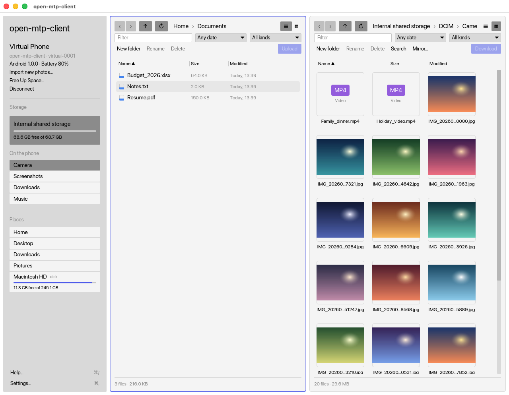

# open-mtp-client

[](https://github.com/kidpeterpan/open-mtp-client/actions/workflows/ci.yml)
[](LICENSE)
[](https://buymeacoffee.com/kidpeterpan)

Copy files between your Mac and your Android phone. It tells you what is wrong when it can't connect.

A free, open source Mac app written in Rust. No telemetry. No network code.

Website: [kidpeterpan.github.io/open-mtp-client](https://kidpeterpan.github.io/open-mtp-client/)

<picture>
  <source media="(prefers-color-scheme: dark)" srcset="docs/screenshots/main-dark.png">
  
</picture>

<sub>Shown with a virtual phone and sample files.</sub>

## Why

Using an Android phone with a Mac is painful:

- **Your phone is invisible.** macOS can't talk to Android phones, so nothing shows up in Finder.
- **"No device found."** That's all you get. No reason, no fix.
- **Other apps steal the phone.** Photos, Image Capture and Android File Transfer grab it first.
- **Copies fail halfway.** Then you start over.
- **Copies can be wrong.** And nobody tells you.

open-mtp-client fixes these. It explains every failure, frees the phone when macOS is in the way, resumes copies
and checks every file.

## Install

You need macOS 11 or later (Apple Silicon or Intel).

### Download (easiest)

1. Get the latest `.dmg` from the [Releases page](https://github.com/kidpeterpan/open-mtp-client/releases/latest).
2. Open it and drag **open-mtp-client** onto **Applications**.
3. Open the app.

The first time, macOS says it can't check the app for malware. That is because the app is not notarized yet
(Apple charges a yearly fee for that). It is safe to open if you downloaded it from this page:

- **macOS 15 or later:** try to open the app, then go to **System Settings > Privacy & Security**,
  scroll down and click **Open Anyway**.
- **macOS 14 or earlier:** right-click the app, choose **Open**, then **Open** again.

You only do this once. Prefer not to trust a download? Build it yourself below.

### Build from source

It takes a few minutes.

```sh
# 1. Compiler tools
xcode-select --install

# 2. Rust 1.90 or newer
curl --proto '=https' --tlsv1.2 -sSf https://sh.rustup.rs | sh

# 3. Build the app
git clone https://github.com/kidpeterpan/open-mtp-client.git
cd open-mtp-client
make app

# 4. Run it
open dist/open-mtp-client.app
```

An app you build yourself opens without the warning above. Run `make dmg` to make the same `.dmg` as the release.

Want to try it with no phone? Run `make run-virtual`.

## Connect your phone

1. Plug it in with a data cable (some cables only charge).
2. Unlock the phone.
3. Pull down the notification shade, tap the USB notification and choose **File transfer**.
4. Quit Android File Transfer if it is running.

Still stuck? Open **Help > Troubleshooting**. It checks your Mac and tells you what to fix.

## Features

✅ done · 🚧 planned

| | |
|---|---|
| **Connect** | |
| Find out why a phone won't connect, with a fix for each cause | ✅ |
| Free the phone from macOS camera services and other apps | ✅ |
| Use several phones at once | ✅ |
| Show battery, storage and USB speed | ✅ |
| **Copy** | |
| Copy both ways with progress, speed and cancel | ✅ |
| Pause and resume. Carry on after a lost cable or a restart | ✅ |
| Check every file before removing the original | ✅ |
| One bad file never stops the rest | ✅ |
| Files over 4 GB, and any file name (emoji, Thai, `? : #`) | ✅ |
| Stop early if there isn't enough room | ✅ |
| Keep the Mac awake while copying | ✅ |
| **Browse** | |
| Two panes: phone and Mac side by side | ✅ |
| List and grid view with photo thumbnails | ✅ |
| Fast with tens of thousands of files | ✅ |
| Search the phone by name, type or date | ✅ |
| Sort, filter, group by date | ✅ |
| **Organise** | |
| Cut, copy, paste, rename, delete, undo | ✅ |
| Rename many files at once | ✅ |
| Drag and drop from Finder | ✅ |
| Edit a phone file in a Mac app and send it back | ✅ |
| **Photos and backup** | |
| Import only new photos, into folders by date | ✅ |
| One-way folder sync with a preview | ✅ |
| Find duplicates and big files to free up space | ✅ |
| **Feels like a Mac app** | |
| Menu bar, Quick Look, Finder shortcuts | ✅ |
| Dock progress and notifications | ✅ |
| Light and dark theme | ✅ |
| Command line tool for scripts | ✅ |
| More languages (Thai first): Thai, Japanese, Simplified Chinese | ✅ |
| **Next** | |
| Video thumbnails | 🚧 |
| Signed downloads and Homebrew | 🚧 |
| Show the phone in Finder | 🚧 |
| Copy phone to phone | 🚧 |

## Languages

open-mtp-client speaks English, Thai, Japanese and Simplified Chinese. Choose one in Settings › Language, or leave it on "Follow the Mac".

Every word the window shows is in four text files in `cmd/open-mtp-client/i18n/locales/`: `en.txt`, `th.txt`, `ja.txt` and `zh-Hans.txt`. English is the source: a message exists only if `en.txt` has it. This README, the command line tool and the report in Help › About stay in English.

**To correct a word**, edit its line in that language's file and nothing else.

```text
# a note, ignored
transfer.done.title = Copied {count} files
```

- One message is one line: `key = value`. Keep the key as it is and change only the value.
- `{name}` and `{count}` mark where a name or a number goes. Keep every `{…}` exactly as in English, and write the whole sentence around it. Names from the phone or the Mac are put in by the app, never translated.
- Use short, everyday words, and the same word for the same thing (each file starts with a few `#` lines listing the words it uses).
- Thai: put a space between phrases. The window wraps Thai only at spaces, so a long run of letters with none runs off the edge (at most 24 Thai letters in a row).
- Only `en.txt` has `.one` lines (the form for exactly 1); Thai, Japanese and Chinese write one line for any number.

Then run `make test`. It checks that all four files have the same messages and the same `{…}` slots, that Thai has its spaces, and that no English words are left in another language. To see the result, run `make run-virtual` and pick the language in Settings.

**To add a language**, copy `en.txt` to a new file in the same folder and translate it. A new language also needs a few lines of Rust (the list in `internal/dto/language.rs` and the files embedded in `cmd/open-mtp-client/i18n/mod.rs`): open an issue saying which language, and we will help with that part.

## Command line

The app includes a tool for scripts. See `open-mtp-client-cli --help`.

```sh
open-mtp-client-cli phones
open-mtp-client-cli ls /DCIM/Camera
open-mtp-client-cli pull /DCIM/Camera ~/Pictures/phone
open-mtp-client-cli push ~/notes.txt /Download
```

## Contribute

Bug reports, phone reports ("works on my Pixel 8") and pull requests are welcome.
Read [CONTRIBUTING.md](CONTRIBUTING.md) to get started. For security problems, see [SECURITY.md](SECURITY.md).

## Support

It's free. If it saved you time, you can [buy me a coffee](https://buymeacoffee.com/kidpeterpan).

## License

[MIT](LICENSE). It includes a patched copy of [mtp-rs](https://github.com/vdavid/mtp-rs) in `vendor/`, which keeps its own licenses.
